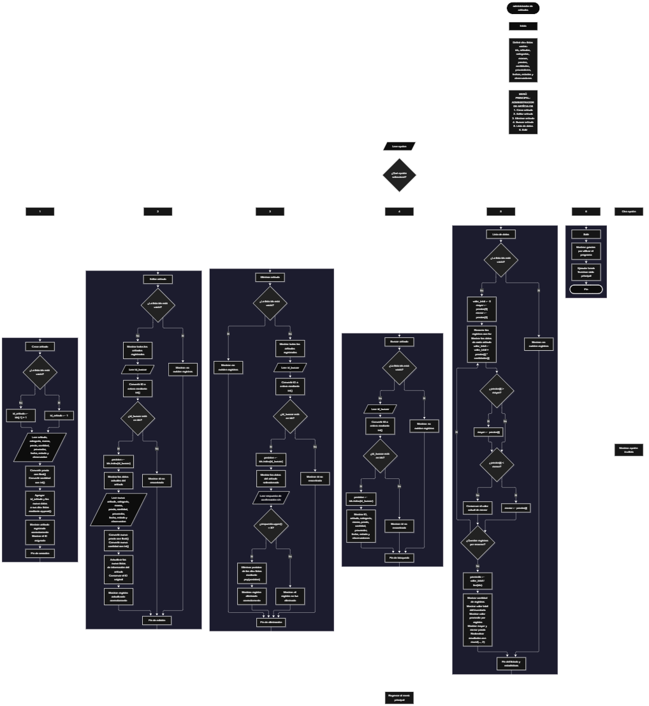

 

Este proyecto, llamado <b>administrador de artículos</b>, fue desarrollado en <b>python</b> como un ejercicio práctico para fortalecer la lógica de programación mediante la creación de un sistema de gestión de artículos desde la consola. El programa cuenta con un menú principal de seis opciones que permite <b>crear, editar, eliminar, buscar y listar los artículos registrados</b>, además de consultar estadísticas relacionadas con el inventario. Cada artículo almacena información como el nombre, la categoría, la marca, el precio, la cantidad disponible, el proveedor, la fecha de ingreso, el estado y las observaciones. Los datos se organizan mediante diez listas paralelas que mantienen la información relacionada de cada artículo durante la ejecución del programa. Durante su desarrollo se aplicaron conceptos fundamentales de programación, como variables, listas, estructuras condicionales, ciclos repetitivos, búsqueda de registros, modificación y eliminación de datos, además de operaciones aritméticas para calcular estadísticas del inventario. Este proyecto permite poner en práctica los conocimientos adquiridos en python y sirve como base para desarrollar sistemas de gestión de inventarios más avanzados utilizando otros lenguajes y tecnologías.

<h2 align="center">⚙️ Funcionamiento del menú principal</h2>

### ➕ Crear artículo

La opción <b>1) crear artículo</b> permite registrar un nuevo artículo en el sistema. Antes de asignar el identificador, el programa comprueba si la lista <b>ids</b> está vacía mediante la condición <b>len(ids) == 0</b>. Si no existen registros, asigna el ID <b>1</b> mediante la variable <b>id_articulo</b>. Si ya existen artículos, obtiene el último identificador almacenado y le suma uno utilizando la expresión <b>ids[-1] + 1</b>. Después, solicita el <b>nombre del artículo, categoría, marca, precio, cantidad disponible, proveedor, fecha de ingreso, estado y observación</b>. El precio se convierte a un número decimal mediante <b>float()</b> y la cantidad disponible se convierte a un número entero mediante <b>int()</b>. A continuación, almacena el identificador y los nueve datos del artículo en sus respectivas listas mediante el método <b>append()</b>. Finalmente, muestra los mensajes <b>"artículo registrado correctamente."</b> y el identificador asignado. El registro se mantiene en memoria durante la ejecución del programa.

### ✏️ Editar artículo

La opción <b>2) editar artículo</b> permite modificar la información de un artículo registrado. Primero, el programa comprueba si existen registros mediante la condición <b>len(ids) == 0</b>. Si no hay artículos almacenados, muestra el mensaje <b>"no existen registros."</b>. En caso contrario, utiliza un ciclo <b>for</b> para recorrer las listas y mostrar los datos de todos los artículos. Después, solicita el identificador del registro que se desea editar y lo convierte a entero mediante <b>int()</b>. El programa comprueba si el identificador se encuentra en la lista <b>ids</b>. Si existe, obtiene su posición utilizando <b>ids.index(id_buscar)</b>, muestra los datos actuales y solicita la nueva información del artículo. Los valores actualizados se guardan directamente en las nueve listas de información, mientras que el identificador original permanece sin cambios. Finalmente, muestra el mensaje <b>"registro actualizado correctamente."</b>. Si el ID no se encuentra en la lista, presenta el mensaje <b>"id no encontrada."</b>.

### 🗑️ Eliminar artículo

La opción <b>3) eliminar artículo</b> permite eliminar un registro del inventario mediante su identificador. Primero, el programa comprueba si existen artículos almacenados. Si las listas están vacías, muestra el mensaje <b>"no existen registros."</b>. Si hay registros disponibles, presenta todos los artículos mediante un ciclo <b>for</b> y solicita el ID del registro que se desea eliminar. Después, comprueba si el identificador existe en <b>ids</b> y obtiene su posición con <b>ids.index(id_buscar)</b>. Si el artículo se encuentra, muestra sus datos y solicita una confirmación mediante la pregunta <b>"¿desea eliminar este registro? (s/n):"</b>. La respuesta se convierte a mayúsculas con <b>upper()</b> y, si es igual a <b>"S"</b>, el programa elimina la posición correspondiente de las diez listas mediante el método <b>pop(posicion)</b>. Esta operación mantiene alineados los datos de los artículos restantes. Finalmente, muestra el mensaje <b>"registro eliminado correctamente."</b>. Si el usuario no confirma la eliminación, presenta el mensaje <b>"el registro no fue eliminado."</b>. Si el ID no existe, informa que no fue encontrado.

### 🔎 Buscar artículo

La opción <b>4) buscar artículo</b> permite localizar un artículo mediante su identificador. Primero, el programa comprueba si existen registros almacenados. Si no hay artículos, muestra el mensaje <b>"no existen registros."</b>. En caso contrario, solicita el ID que se desea buscar y convierte el valor introducido a entero mediante <b>int()</b>. A continuación, utiliza la condición <b>id_buscar in ids</b> para comprobar si el identificador existe. Si encuentra una coincidencia, obtiene la posición correspondiente con <b>ids.index(id_buscar)</b> y muestra los datos completos del artículo, incluyendo el nombre, la categoría, la marca, el precio, la cantidad, el proveedor, la fecha de ingreso, el estado y las observaciones. Si el identificador no se encuentra, presenta el mensaje <b>"id no encontrada."</b>. Esta función facilita consultar un registro específico sin necesidad de recorrer manualmente toda la información.

### 📋 Lista de datos

La opción <b>5) lista de datos</b> permite visualizar todos los artículos registrados y consultar las estadísticas del inventario. Primero, el programa comprueba si existen registros mediante <b>len(ids) == 0</b>. Si las listas están vacías, muestra el mensaje <b>"no existen registros."</b>. Si hay artículos, inicializa la variable <b>valor_total</b> en cero y establece las variables <b>mayor</b> y <b>menor</b> con el primer precio almacenado en <b>precios[0]</b>. Después, utiliza un ciclo <b>for</b> para recorrer los registros, mostrar los datos de cada artículo y calcular el valor total del inventario mediante la expresión <b>valor_total += precios[i] * cantidades[i]</b>. Durante el recorrido, compara los precios para identificar el artículo con el precio unitario más alto y el más bajo. Al terminar, calcula el valor promedio por registro mediante la expresión <b>promedio = valor_total / len(ids)</b>. Finalmente, muestra la cantidad de registros, el valor total del inventario, el valor promedio por registro, el artículo más costoso y el artículo más económico. Los resultados monetarios se redondean a dos decimales mediante <b>round(..., 2)</b>. Es importante señalar que el promedio corresponde al valor total del inventario dividido entre la cantidad de registros, no al promedio de los precios unitarios.

### 🚪 Salir del menú principal

La opción <b>6) salir</b> permite finalizar la ejecución del programa. Cuando el usuario selecciona esta opción, el sistema muestra el mensaje <b>"gracias por utilizar el programa."</b> y ejecuta la instrucción <b>break</b>, que interrumpe el ciclo <b>while True</b> y termina el menú principal. A diferencia de las demás opciones, esta operación no necesita consultar ni modificar las listas de artículos. Los datos se encuentran almacenados únicamente en la memoria del programa, por lo que no se conservan después de finalizar la ejecución.

<h2 align="center">🧠 Temas aplicados en el proyecto</h2>

### 📦 Variables

En este proyecto se utilizan variables para almacenar los datos introducidos por el usuario, controlar los identificadores de los artículos, localizar registros, gestionar la confirmación de eliminaciones y calcular las estadísticas del inventario. Cada variable cumple una función específica dentro de las operaciones del sistema y permite organizar el procesamiento de la información.

🔢 <b>opcion:</b> Almacena la opción seleccionada por el usuario en el menú principal.

🆔 <b>id_articulo:</b> Almacena el identificador asignado al nuevo artículo.

🔎 <b>id_buscar:</b> Guarda el identificador introducido para buscar, editar o eliminar un registro.

📍 <b>posicion:</b> Indica la posición del artículo dentro de las listas paralelas.

📝 <b>articulo, categoria, marca, proveedor, fecha, estado y observacion:</b> Almacenan temporalmente los datos introducidos para registrar un artículo.

💲 <b>precio y cantidad:</b> Almacenan el precio unitario y la cantidad disponible del artículo que se registra o actualiza.

📊 <b>valor_total:</b> Acumula el valor monetario del inventario mediante la multiplicación de los precios por las cantidades disponibles.

📈 <b>promedio:</b> Almacena el resultado de dividir el valor total del inventario entre la cantidad de registros.

⬆️ <b>mayor:</b> Guarda el precio unitario más alto encontrado durante el recorrido de los artículos.

⬇️ <b>menor:</b> Guarda el precio unitario más bajo encontrado durante el recorrido de los artículos.

🔁 <b>i:</b> Funciona como variable de control del ciclo <b>for</b> para recorrer los registros y acceder a los datos de cada artículo.

### 🗃️ Listas

El proyecto utiliza diez listas paralelas para almacenar los datos de los artículos registrados. Todas las listas se relacionan mediante el mismo índice, de modo que los valores ubicados en una misma posición corresponden al mismo artículo. Por ejemplo, los datos de un registro ubicado en la posición <b>0</b> se encuentran distribuidos entre <b>ids[0], articulos[0], categorias[0], marcas[0], precios[0], cantidades[0], proveedores[0], fechas[0], estados[0]</b> y <b>observaciones[0]</b>. Esta organización facilita agregar, consultar, modificar, mostrar y eliminar registros manteniendo la relación entre sus datos.

🆔 <b>ids:</b> Almacena los identificadores de los artículos registrados.

📝 <b>articulos:</b> Almacena los nombres de los artículos.

🗂️ <b>categorias:</b> Almacena las categorías de los artículos.

🏷️ <b>marcas:</b> Almacena las marcas correspondientes.

💲 <b>precios:</b> Almacena los precios unitarios de los artículos.

📦 <b>cantidades:</b> Almacena las cantidades disponibles de cada artículo.

🚚 <b>proveedores:</b> Almacena los nombres de los proveedores.

📅 <b>fechas:</b> Almacena las fechas de ingreso introducidas por el usuario.

📌 <b>estados:</b> Almacena los estados de los artículos.

📄 <b>observaciones:</b> Almacena las observaciones adicionales de cada registro.

### 🔀 Estructuras condicionales

En este proyecto se utilizan las estructuras <b>if, elif y else</b> para seleccionar las operaciones del menú y comprobar las condiciones necesarias para ejecutarlas. Estas estructuras permiten determinar si existen registros, verificar si un identificador se encuentra en la lista <b>ids</b>, decidir si un artículo debe eliminarse según la respuesta del usuario y distinguir entre una opción válida y una opción incorrecta. También se utilizan para actualizar los valores de <b>mayor</b> y <b>menor</b> durante el cálculo de las estadísticas del inventario.

### 🔄 Estructuras repetitivas

El programa utiliza los ciclos <b>while</b> y <b>for</b> para controlar la ejecución y recorrer los registros. El ciclo <b>while True</b> mantiene activo el menú principal hasta que el usuario selecciona la opción de salida y se ejecuta <b>break</b>. Por otro lado, los ciclos <b>for</b> permiten recorrer las listas para mostrar los artículos registrados y calcular las estadísticas del inventario. Estas estructuras facilitan la ejecución repetida de operaciones sin tener que escribir instrucciones individuales para cada artículo.

### 🎯 Selección de opciones

El menú principal utiliza una cadena de condiciones <b>if, elif y else</b> para determinar qué operación debe ejecutarse según el valor de la variable <b>opcion</b>. Las opciones del <b>1</b> al <b>5</b> permiten crear, editar, eliminar, buscar y listar artículos, mientras que la opción <b>6</b> finaliza el programa. El bloque <b>else</b> muestra el mensaje <b>"opción inválida."</b> cuando el usuario introduce un valor que no coincide con ninguna de las opciones definidas.

### 🔢 Conversión de tipos de datos

El programa utiliza las funciones <b>int()</b> y <b>float()</b> para convertir los valores introducidos por el usuario en tipos de datos adecuados para las operaciones. Los identificadores y las cantidades se convierten a números enteros mediante <b>int()</b>, mientras que los precios se convierten a números decimales mediante <b>float()</b>. Estas conversiones permiten comparar identificadores, actualizar cantidades y realizar los cálculos monetarios del inventario. Sin embargo, el código no incluye manejo de excepciones, por lo que una entrada no numérica en estos campos puede interrumpir la ejecución.

### 🔍 Búsqueda y acceso a registros

La búsqueda de artículos se realiza mediante el operador <b>in</b>, que comprueba si un identificador está presente en la lista <b>ids</b>. Cuando existe una coincidencia, el método <b>index()</b> permite obtener la posición del registro para acceder a los datos relacionados en las demás listas. Esta misma lógica se aplica en las operaciones de edición, eliminación y búsqueda, evitando tener que comparar manualmente cada identificador.

### 🧮 Operaciones aritméticas y estadísticas

El proyecto aplica operaciones aritméticas para calcular el valor del inventario y obtener estadísticas sobre los precios de los artículos. La expresión <b>precios[i] * cantidades[i]</b> calcula el valor correspondiente a cada registro y el operador <b>+=</b> acumula estos valores en la variable <b>valor_total</b>. Las comparaciones entre los precios permiten identificar el mayor y el menor, mientras que la división entre el valor total y la cantidad de registros permite obtener el promedio por registro. La función <b>round()</b> se utiliza para presentar los resultados monetarios con dos decimales.

### 🧹 Métodos de listas

El sistema utiliza los métodos <b>append()</b>, <b>pop()</b> e <b>index()</b> para administrar los registros. El método <b>append()</b> incorpora los nuevos datos al final de cada lista; <b>index()</b> localiza la posición de un identificador existente; y <b>pop()</b> elimina el elemento situado en una posición determinada. Durante la eliminación de un artículo, se utiliza el mismo índice en las diez listas para evitar que los datos de un artículo queden relacionados incorrectamente con los de otro.

<h2 align="center">¿Cómo se implementaron las operaciones crud en el proyecto?</h2>

Las operaciones <b>crud</b> se implementaron mediante las opciones del menú principal y permiten administrar los artículos registrados. La operación <b>crear</b> corresponde a <b>crear artículo</b>, donde se introduce un nuevo registro con su identificador y sus nueve campos de información. La operación <b>leer</b> se realiza mediante <b>buscar artículo</b> y <b>lista de datos</b>, que permiten consultar un artículo específico o visualizar todos los registros junto con las estadísticas del inventario. La operación <b>actualizar</b> corresponde a <b>editar artículo</b>, donde se modifican los datos de un registro existente sin cambiar su identificador. Por último, la operación <b>eliminar</b> se realiza mediante <b>eliminar artículo</b>, que solicita confirmación antes de quitar el registro de las diez listas. Estas operaciones utilizan listas, condicionales, ciclos y métodos integrados de python para administrar la información temporalmente almacenada.

<h2 align="center">Diagrama de flujo del proyecto</h2>

<h2 align="center">🛡️ Validaciones del programa</h2>

### 📭 No existen registros

Esta comprobación se utiliza en las opciones de <b>editar, eliminar, buscar y lista de datos</b>. El programa verifica si la lista <b>ids</b> está vacía mediante la condición <b>len(ids) == 0</b>. Si no existen artículos registrados, muestra el mensaje <b>"no existen registros."</b> y no continúa con la operación solicitada. Esta comprobación evita intentar localizar o mostrar registros cuando las listas todavía no contienen información.

### ❌ Identificador no encontrado

Esta comprobación se utiliza durante las operaciones de <b>editar, eliminar y buscar artículo</b>. El programa verifica si el valor de <b>id_buscar</b> está presente en la lista <b>ids</b>. Si existe, utiliza <b>ids.index(id_buscar)</b> para localizar la posición correspondiente y continuar con la operación. Si no encuentra el identificador, muestra el mensaje <b>"id no encontrada."</b>. Esta comprobación permite evitar el acceso a un registro mediante un identificador que no está almacenado.

### ⚠️ Confirmación de eliminación

Antes de eliminar un artículo, el programa solicita al usuario que confirme la operación mediante la pregunta <b>"¿desea eliminar este registro? (s/n):"</b>. La respuesta se convierte a mayúsculas utilizando <b>upper()</b>. Si el resultado es igual a <b>"S"</b>, el programa elimina el registro de las diez listas mediante <b>pop(posicion)</b> y muestra el mensaje <b>"registro eliminado correctamente."</b>. Si la respuesta es distinta de <b>"S"</b>, no elimina los datos y presenta el mensaje <b>"el registro no fue eliminado."</b>.

### 🔢 Conversión de datos numéricos

El programa convierte los identificadores y las cantidades a números enteros mediante <b>int()</b>, y los precios a números decimales mediante <b>float()</b>. Estas conversiones permiten realizar búsquedas y operaciones aritméticas con los tipos de datos esperados. Sin embargo, no existe una validación adicional para comprobar que las entradas sean numéricas antes de convertirlas. Si el usuario introduce un valor incompatible, python puede generar un error y detener la ejecución. Tampoco se comprueba que los precios o las cantidades sean positivos.

### 🆔 Asignación de identificadores

El sistema asigna automáticamente los identificadores durante el registro de nuevos artículos. Si la lista <b>ids</b> está vacía, asigna el valor <b>1</b>; de lo contrario, suma uno al último identificador almacenado mediante <b>ids[-1] + 1</b>. Este procedimiento funciona con el orden de registro habitual, pero no garantiza identificadores únicos en todos los casos. Si se elimina el último registro y se crea otro artículo, el programa puede reutilizar un identificador que se había eliminado. El código no incluye un contador independiente para conservar el último ID asignado.

### ⚠️ Opción inválida

El menú principal utiliza una cadena de condiciones para identificar las opciones disponibles. Si el valor introducido no coincide con los números del <b>1</b> al <b>6</b>, el bloque <b>else</b> muestra el mensaje <b>"opción inválida."</b>. Esta comprobación permite informar al usuario cuando selecciona una opción que no está definida en el menú.

### 💾 Almacenamiento temporal

Los artículos se almacenan en listas creadas al comienzo del programa. La información permanece disponible mientras el ciclo principal se encuentra en ejecución, pero no se guarda en archivos ni en una base de datos. Por este motivo, cuando el usuario selecciona la opción de salida o el programa termina, los registros almacenados en memoria dejan de estar disponibles. El código tampoco implementa mecanismos de recuperación de datos entre ejecuciones.

<h2 align="center">🎯 Objetivo del proyecto</h2>

El objetivo principal de este proyecto es fortalecer la <b>lógica de programación</b> mediante el desarrollo de un sistema de administración de artículos en <b>python</b>. A través de su construcción se busca aplicar los conocimientos adquiridos sobre variables, listas, estructuras condicionales, ciclos repetitivos, conversión de tipos de datos y operaciones aritméticas. Además, el proyecto permite comprender cómo registrar, consultar, modificar y eliminar información, así como calcular estadísticas básicas de un inventario. De esta manera, constituye una base para desarrollar aplicaciones de gestión más completas que incorporen almacenamiento persistente, validaciones de datos y funcionalidades adicionales.

